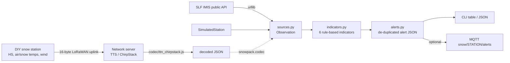

# snowpack-sentinel

A small, readable pipeline for a low-power snow station: **LoRaWAN payload codec -> ingestion -> snowpack indicators -> alert JSON.**
It runs on a built-in simulated station and on real, public station data from the SLF IMIS network.

> **Disclaimer.** This project computes raw indicators from station data for engineering and education.
> It is **not an avalanche forecast** and must not be used for safety decisions.
> The official Swiss avalanche bulletin is published by the WSL Institute for Snow and Avalanche Research SLF (slf.ch).
> No affiliation with any company or institute is claimed.


<sub>Left: the simulated 8-day scenario (`python -m snowpack simulate`). Right: live public SLF IMIS data for station DAV2, the last 24 h the API returned (ending 2026-11-07 22:30 UTC). Follow SLF's data terms if you reuse that data.</sub>

## Why

A snow station that talks over LoRaWAN has to squeeze its measurements into a few bytes per uplink, and whoever
receives them wants more than numbers: "did a lot of snow fall, is it windy, is the pack building a steep
temperature gradient, is it warming fast?". This repo shows that whole path end to end with simple, inspectable
rules (every formula is in a docstring and in the table below), no model weights, and one dependency (numpy).

## Architecture



## Quickstart

```bash
pip install -e ".[dev]"          # numpy only; add ".[mqtt]" for --mqtt
python -m pytest -q              # offline, no network
node codec/test_codec.js         # same test vectors through the JS decoder

python -m snowpack simulate                       # 8-day synthetic scenario
python -m snowpack simulate --via-codec --json    # quantised through the LoRaWAN codec first
python -m snowpack stations --canton GR --type SNOW_FLAT
python -m snowpack live DAV2 --hours 72
python -m snowpack decode 04d2fea2fd8ffe3eff38ffce153187a0
python -m snowpack simulate --mqtt localhost      # publishes the report to snow/SIM1/alerts
```

Live data comes from the public SLF/WSL measurement API (`measurement-api.slf.ch`). **You are responsible for following
SLF's data terms of use and attribution requirements** when you use or redistribute that data. This repo does not
contain any downloaded SLF data; test fixtures are synthetic.

## Uplink format (16 bytes, big-endian)

| Bytes | Field | Encoding | Invalid |
|------:|-------|----------|---------|
| 0-1 | flags (bits 15..13) + snow height HS (bits 12..0) | HS in mm, 0..8190 | HS = 0x1FFF |
| 2-3 | air temperature TA | int16, 0.01 C | 0x8000 |
| 4-5 | snow surface temperature TSS | int16, 0.01 C | 0x8000 |
| 6-7 | temperature 25 cm above ground | int16, 0.01 C | 0x8000 |
| 8-9 | temperature 50 cm above ground | int16, 0.01 C | 0x8000 |
| 10-11 | temperature 100 cm above ground | int16, 0.01 C | 0x8000 |
| 12 | wind mean | uint8, 0.2 m/s (max 50.8) | 0xFF |
| 13 | wind gust | uint8, 0.2 m/s | 0xFF |
| 14 | wind direction | uint8, 2 degrees (0..178) | >= 180 |
| 15 | battery | uint8, 2000 mV + 10 mV * n | 0xFF |

Flags: bit 0 low battery, bit 1 sensor fault, bit 2 event (threshold wake-up). Values out of range saturate.
Python (`snowpack/codec.py`) and JavaScript (`codec/ttn_chirpstack.js`, ES5, `decodeUplink(input)` ->
`{data, warnings}` or `{errors}`, usable in The Things Stack and ChirpStack v4) are checked against the same vectors in
`examples/vectors.json`. The first vector is computed by hand; the rest were generated by `examples/make_vectors.py`.

## Indicators

All thresholds are textbook-style simplifications. Levels: `none` / `watch` / `warning`.

| Indicator | Formula | Watch | Warning | Basis |
|-----------|---------|-------|---------|-------|
| `new_snow_24h` / `new_snow_72h` (HN) | Rises of the median-filtered HS series >= 1 cm above a reference that follows HS downward (so settlement and sensor noise are ignored), summed over the window | 24 h: 20 cm; 72 h: 30 cm | 24 h: 30 cm; 72 h: 50 cm | New-snow depth over 1-3 days is a standard avalanche-problem input; the exact numbers here are rules of thumb |
| `wind_drift` | HN24 x share of the last 24 h with mean wind between 4 and 12 m/s | 8 cm | 15 cm | Wind of moderate strength transports loose snow; weaker does not, much stronger mostly scours |
| `temp_gradient` | (T_lowest buried sensor - TSS) / (HS - sensor height), mean over 24 h; warning if the 72 h mean also exceeds the limit with >= 48 h of data | > 10 C/m | > 10 C/m persistent | A gradient above roughly 10 C/m is commonly cited as favouring faceting (weak layers) |
| `rapid_warming` | mean TA of last hour - min TA of last 24 h; plus wet-snow rule: snow >= 10 cm, TA > 0 C and TSS >= -0.5 C | 10 C | 15 C, or wet-snow rule | Fast warming and a surface at 0 C point to loss of strength through wetting |
| `settlement` | % of snow depth lost per day over 24 h, only if no new snow | 5 %/day | 10 %/day | Fast compaction without snowfall usually means melt or strong metamorphism |

`alerts.py` evaluates the indicators hourly on a trailing 72 h window and de-duplicates: an alert is emitted when an
indicator escalates, and repeated as a reminder only after 24 h. Falling levels and flapping are silent.

### Alert JSON (one per station and moment)

```json
{
  "station": "SIM1", "generated_at": "2026-01-17T23:30:00Z", "overall_level": "watch",
  "indicators": [{"name": "settlement", "value": 6.2, "unit": "%/day", "level": "watch",
                  "reason": "snow depth 85.7 -> 80.6 cm, 6.2 %/day"}],
  "alerts": [{"station": "SIM1", "time": "2026-01-11T16:00:00Z", "indicator": "new_snow_24h",
              "level": "watch", "value": 22.5, "unit": "cm", "reason": "..."}],
  "disclaimer": "..."
}
```

## Sample output

### Live (2026-11-07, station DAV2, SLF IMIS API)

The API returned 48 half-hourly samples (about 24 h), so `--hours 72` covered everything available. Early season with
1-2 cm of snow: nothing to report, and the gradient indicator correctly refuses to compute on a pack thinner than 20 cm.

```text
live: DAV2, 48 samples, 2026-11-06 15:00 -> 2026-11-07 14:30 UTC
latest: HS 1.7 cm, TA -2.6 C, TSS 0.2 C, wind 0.8 m/s

indicator           value unit   level    reason
new_snow_24h          1.1 cm     none     1.1 cm new snow in 24 h (thresholds 20/30 cm)
new_snow_72h          1.1 cm     none     1.1 cm new snow in 72 h (thresholds 30/50 cm)
wind_drift            0.0 cm     none     HN24 1.1 cm x 0% of time with 4-12 m/s wind
temp_gradient           - C/m    none     too little snow (<0.2 m measured) or missing sensors
rapid_warming         1.1 C      none     air temperature up 1.1 C in 24 h
settlement              - %/day  none     new snow in last 24 h; settlement not evaluated

overall: none

no alerts in window
```

### Simulated scenario (`python -m snowpack simulate`)

Eight synthetic days: calm, a 38 cm storm with wind, settling, clear cold nights, then a rapid warm-up. Alerts in order:

```text
  2026-01-11T15:00:00Z  watch   wind_drift     HN24 18.7 cm x 45% of time with 4-12 m/s wind
  2026-01-11T16:00:00Z  watch   new_snow_24h   22.5 cm new snow in 24 h (thresholds 20/30 cm)
  2026-01-11T18:00:00Z  warning wind_drift     HN24 28 cm x 57% of time with 4-12 m/s wind
  2026-01-11T19:00:00Z  warning new_snow_24h   30.7 cm new snow in 24 h (thresholds 20/30 cm)
  2026-01-11T19:00:00Z  watch   new_snow_72h   30.7 cm new snow in 72 h (thresholds 30/50 cm)
  2026-01-13T18:00:00Z  watch   temp_gradient  mean gradient 10.1 C/m over 24 h, 7.4 C/m over 72 h (limit 10)
  2026-01-14T19:00:00Z  warning temp_gradient  mean gradient 13.6 C/m over 24 h, 10.1 C/m over 72 h (limit 10)
  2026-01-17T11:00:00Z  watch   rapid_warming  air temperature up 11.1 C in 24 h
  2026-01-17T12:00:00Z  warning rapid_warming  air temperature up 12.7 C in 24 h; TA 0.7 C > 0 with surface at 0.0 C: wet-snow risk
  2026-01-17T17:00:00Z  watch   settlement     snow depth 86.3 -> 82 cm, 5.2 %/day
```

(24 h reminders omitted from this excerpt. The test suite asserts this order.)

## Repo layout

```text
snowpack/    codec.py  sources.py  indicators.py  alerts.py  cli.py  mqtt_out.py
codec/       ttn_chirpstack.js  test_codec.js
examples/    vectors.json  make_vectors.py
tests/       codec, parser (synthetic fixtures), indicators with known answers, end-to-end scenario
```

## Limits / not verified

- **Not field tested.** No hardware was used; the codec and pipeline have only seen simulated frames and public IMIS data.
- Thresholds are textbook simplifications, not calibrated to any site, snow climate or sensor, and not validated against avalanche observations.
- The simulated scenario is hand-tuned to exercise each indicator; it is not a physical snow model.
- IMIS snow-surface and ground temperatures are used as if they were a clean linear profile; real packs have layers, and the buried-sensor logic is a simplification. Gradient needs at least 20 cm of snow over a buried sensor.
- Diurnal temperature swings on clear days can approach the rapid-warming threshold; the indicator does not remove the daily cycle.
- Wind-drift ignores wind direction, terrain and snow type; it is a proxy, not a loading model.
- The live API call returned about 24 h at the time of writing; behaviour for longer windows is untested. The MQTT output path is untested against a broker.
- No handling of sensor drift, ultrasonic temperature compensation, or LoRaWAN frame counters/duplicates.

## Next steps

- Real hardware: ultrasonic snow-depth sensor plus a thermistor string on an STM32 with a LoRa module, deep sleep, event wake-up on HS change; write the matching firmware packer.
- Couple to a physical snow-cover model (for example SNOWPACK) driven by the station data, and compare its stability output with these simple indicators.
- Grafana dashboard fed from the MQTT topic or a time-series database.
- Wind direction aware loading, diurnal-cycle removal, per-site thresholds.
- Validate against SLF/IMIS history for known events.

## License

MIT, see `LICENSE`.
